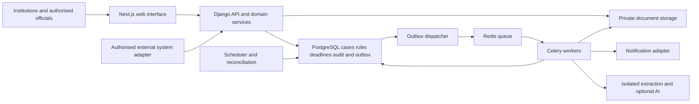

# SIH 26262 Research and Build Blueprint

Prepared for the SIH 2026 participant team on 21 October 2026

## 1 Recommended project

Build an approval operations and continuing compliance platform in which every case has a valid route, every pending action has an accountable owner, every deadline has a traceable basis, and every closure has verified evidence.

The most useful distinguishing feature is **a traceable obligation and evidence register**. Connect the application, committee findings, approval conditions, institutional undertakings, document versions, deadlines, submissions, verification decisions and escalation history. An officer should be able to open an overdue case and immediately understand what is required, why, who must act, what evidence exists and what action is permitted next.

The main demonstration should follow one realistic case from submission through scrutiny, a deficiency response, an EVC, an authorised decision, an undertaking, a document renewal and verified closure. Along the way, show an actual overdue escalation, an attempted unauthorised action and recovery after a worker restart. Add AI to suggest document fields and draft a factual case brief after that complete path works.

Suggested working name: **ApprovalTrack**. Treat this as a project name, not an official AICTE product or endorsement.

Planning assumptions: six team members; approximately four weeks to research, learn and rehearse; a separate 36 hour implementation schedule is included for a constrained event. These are planning assumptions, not verified SIH event rules. Use the organiser's actual rules and schedule when allocating preparation and event work. All example service levels, reminder intervals, institutional records and committee arrangements below are proposed demonstration settings unless explicitly sourced.

This document is a product and engineering plan. It is not a certified regulatory rulebook, a running application or evidence that any live AICTE integration is available.

## 2 Research findings and their implications

### What is verified

AICTE's base handbook covers 2024–25 through 2026–27. Table 2.3 differentiates application routes. The handbook distinguishes hearing and appellate processes, describes restrictions on editing submitted applications, and includes an NSWS entry path for new institutions. These findings support category-aware routing, distinct committee records, controlled amendments and integration with existing systems. Read the relevant clauses with applicable amendments before configuring live rules. [AICTE handbook](https://www.aicte.gov.in/sites/default/files/APH%20Final.pdf)

The Ministry of Education's launch announcement confirms the handbook's three academic year scope and its emphasis on simpler procedures and transparency. It does not establish a processing-time baseline for your proposed system. [Government launch announcement](https://www.pib.gov.in/Pressreleaseshare.aspx?PRID=1983013&lang=2&reg=48)

An AICTE-authored 2026–27 addendum is indexed in a mirrored PDF, with changes including EVC and committee definitions. The full original-hosted addendum was not retrievable during this research. Obtain and verify the official applicable copy before treating its indexed clauses as operational rules. [Indexed AICTE addendum copy](https://avantiscdnprodstorage.blob.core.windows.net/legalupdatedocs/52940/AICTE-issued-the-Corrigendum-regarding-the-Approval-Process-2026-27-February202026.pdf)

The public mirror of SIH26262 extends the supplied excerpt with dashboards, EVC monitoring, undertakings, document validity, notifications, reporting and a human-oversight safeguard. Its evaluation text emphasises routing accuracy, timely alerts, dependable deadlines, visibility and audit completeness. The official SIH page returned an access error, so independently confirm the complete statement on that portal. Ignore the mirror's generic editorial advice and submission counts when making design decisions. [Problem statement mirror](https://zaidsayyed.in/tools/sih-problem-statements/sih26262)

### What this research does not establish

There is no verified public baseline here for current approval turnaround, missed renewals, officer workload or alert failure rates. There is also no verified public production API contract for AICTE application events, expert availability or document authenticity checks. Do not present invented savings, a live government connection or nationwide performance as achieved results.

Existing digital infrastructure matters. NSWS describes forwarding applications to the concerned authority's systems and leaving final decisions with that authority. Position this proposal as an approval operations capability that could integrate with authorised systems. A standalone prototype is a demonstration boundary. [NSWS process explanation](https://www.nsws.gov.in/faqs)

### Source hygiene is itself a product requirement

One retrieved file named `AICTE-APH-26-27.pdf` contains the base handbook and a clearly titled 2025–26 addendum. Its filename does not establish that it includes the latest amendments. Store issuer, document title, academic year, publication date, effective dates, retrieval date, file hash, clause locator and reviewer approval. [Compiled copy inspected](https://edu-ecosys.com/AICTE-APH-26-27.pdf)

Keep three labels visible throughout the project: **verified source**, **proposed design**, and **demo assumption**. An operational service level proposed by your team must never appear as an APH mandate.

## 3 Validate the problem with people before expanding the scope

Try to interview one institutional approval coordinator, one person familiar with scrutiny or EVC work, and one regulatory operations stakeholder. You can conduct useful discovery without access to confidential case files.

Ask them to reconstruct a recent anonymised case. Which action was waiting? Who knew it was waiting? What triggered the next stage? Which clock continued during clarification? What counted as adequate evidence? Who was allowed to change a due date? What happened after approval? Which reports required a spreadsheet outside the portal?

Request blank forms, public approval letters, public notices or redacted samples with permission. Record which statements are direct observations and which are opinions. Count repeated manual steps and the time taken in your observed task; do not extrapolate an interview into a national statistic.

Create a one page process map and have a domain reviewer correct it. The first useful output is a validated route and authority matrix, not a large collection of interface screens.

## 4 Product scope and priorities

P0 is the minimum credible integrated prototype. P1 adds the distinguishing capabilities. P2 is future work.

| Priority | Capability | Demonstrable acceptance condition |
|---|---|---|
| P0 | Identity and scoped access | Institution A cannot access Institution B through pages, APIs, documents or exports |
| P0 | Configurable application routing | Five route fixtures select and complete the intended stages without arbitrary status edits |
| P0 | Scrutiny and controlled return | A deficiency has a reason, evidence request, owner and linked response round |
| P0 | EVC queue and scheduling | Eligible cases enter a queue; overlapping expert assignments are rejected |
| P0 | Undertakings and compliance | Submission creates a verification task; authorised verification determines fulfilment |
| P0 | Lease and document validity | Expiring, expired and renewal-under-review conditions remain distinguishable |
| P0 | Reminders and escalation | Due events survive restart, avoid duplicate internal notifications and expose failures |
| P0 | Actionable dashboards | Every count opens its underlying authorised records with the same filters |
| P0 | Audit and reporting | A case export reconstructs each transition, reason, actor and evidence version |
| P1 | Connected obligation and evidence view | One condition can be traced from source to verified closure |
| P1 | AI assisted extraction and case brief | Suggested fields cite document pages; uncertain values require confirmation |
| P1 | Policy impact preview | A draft rule version shows changed routes or deadlines without altering live cases |
| P1 | EVC slot suggestions | A valid suggested slot can be confirmed by an authorised scheduler |
| P2 | Historical delay prediction | Evaluated on sufficiently representative, lawfully obtained historical cases |
| P2 | Issuer or registry verification | Available only through an authorised, documented integration |
| P2 | Advanced scheduling optimisation | Added after eligibility and conflict rules are dependable |

Allocate approximately 65 percent of implementation effort to P0 functionality, 20 percent to security, testing and recovery, and 15 percent to differentiators and presentation. This allocation is a planning recommendation.

## 5 The feature that should anchor your pitch

### Traceable obligations with evidence based closure

Consider a fictional approval condition requiring a renewed premises document by 30 November 2026. The institution uploads a document containing several dates. The system suggests which is the expiry date, with the document page and matching text. A reviewer confirms the field before it becomes an authoritative date in the register.

The condition record links to the approved source, institution, case, required evidence, due date, verifier and escalation policy. When the reminder window opens, both the institution's task list and the appropriate officer's view reflect the same obligation. If the deadline passes, the condition is overdue and an escalation event records its designated recipient.

The institution then uploads a renewal. The interface shows **Submitted awaiting verification**. It separately states whether submission was on time and whether a currently verified document has expired. Acceptance by the authorised reviewer makes the new version current and fulfils the relevant obligation. Rejection preserves the submission receipt and reopens the required action with reasons. Neither action rewrites the historical expired version.

This solves a specific operations problem: a file upload, a reminder and a regulatory closure are different events. Represent them separately and link them.

Use an obligation lifecycle such as `OPEN`, `EVIDENCE_SUBMITTED`, `UNDER_VERIFICATION`, `FULFILLED` and `CLOSED_WITH_AUTHORISED_REASON`. A rejected submission creates a reasoned verification result and returns the outstanding obligation to `OPEN`. Compute **due soon** and **overdue** from the relevant clock rather than making them mutually exclusive lifecycle states. Separately compute submission timeliness and document validity. A timely institutional submission awaiting an officer must not be labelled an institutional submission default; a verification delay belongs in the verifier's queue.

### The minimum implementation

Use ordinary relational tables and indexed joins. Build a timeline and a linked record panel. A graph database is unnecessary for the prototype. Each relationship should open the referenced source, evidence, task or event. A visual graph is optional; a clear table and timeline can communicate the same logic more reliably.

### A second differentiator

Provide a draft policy comparison. For example, change a **demo operational reminder** from seven days before expiry to fourteen days before expiry. Preview affected reminders, compare the versions and approve publication. Keep existing cases pinned to their prior policy unless an explicitly authorised migration is required. The preview is deterministic recalculation, not an AI prediction or a legal interpretation.

## 6 Actors and authority boundaries

Use capability grants scoped by institution, region, bureau, committee appointment and case assignment. A role name alone is insufficient.

| Actor | Typical actions in the prototype | Boundary |
|---|---|---|
| Institution representative | Draft application, submit, respond, upload evidence, see own published outcomes | Own institution and authorised application cycle |
| Scrutiny member | Review assigned checklist, record findings and recommendations | Assigned stage and permitted evidence |
| Regional or bureau officer | Monitor scoped queues, assign work, record permitted returns and escalations | Granted jurisdiction and capabilities |
| EVC scheduler | Prepare visit proposal, coordinate availability, confirm permitted appointments | Approved eligibility and appointment authority |
| EVC member | Access assigned visit, complete checklist and report | Active appointment and visit scope |
| SHC or SAC member | Review assigned hearing or appeal record | Distinct appointment, purpose and workflow |
| Competent decision authority | Record the decision permitted by delegated authority | Explicit decision grant and prerequisite checks |
| Policy administrator | Draft workflow and deadline configuration | Configuration rights do not confer case decision rights |
| Policy approver | Review and publish a configuration version | Separate publication grant |
| Auditor | Inspect authorised records and exports | Read access with sensitive fields controlled |

Model the actual committee constitution and decision authority after domain validation. A calendar recommendation does not constitute a committee appointment. A system administrator should not automatically receive regulatory approval powers.

## 7 Workflow model

### Separate a case from its stages and decisions

An application is a container. A proposal or request identifies the approval sought. A workflow instance holds the chosen route and pinned policy version. Stage instances record attempts at scrutiny, re-scrutiny, visits or hearings. Committee recommendations and authoritative decisions are separate records.

Start with one proposal per demo application. Preserve a proposal table so later applications with several requests can have different required routes and an explicit aggregation rule. Do not assume that one completed sub-request clears all others.

Application lifecycle examples are `DRAFT`, `SUBMITTED`, `IN_PROCESS`, `DECISION_RECORDED`, `WITHDRAWN` and `CLOSED`. Stage lifecycle examples are `QUEUED`, `ASSIGNED`, `IN_PROGRESS`, `AWAITING_RESPONSE`, `COMPLETED` and `CANCELLED`. These are proposed software states, not official AICTE status codes.

Track outcome, ongoing compliance and appeal separately. An approved application's compliance obligations can remain open after its processing workflow ends. An appeal needs its own linked instance and original decision record.

### Five route fixtures

Demonstrate scrutiny only, scrutiny then EVC, EVC then a conditionally required committee stage, EVC only, and a scrutiny path with a deficiency response and re-scrutiny. Keep SHC and SAC distinct internally. Their selection must follow the applicable approved rule and procedural trigger. Do not turn the phrase SAC/SHC into a combined committee with interchangeable powers.

These fixtures demonstrate routing mechanics. Mapping a real application category to a fixture requires a reviewed rule source. Include an unclassified case that pauses for authorised classification rather than guessing its route.

### Control every transition on the backend

For each command, authenticate the actor; scope the case; check capability, active assignment and current state; compare the expected record version; validate evidence and prerequisites; evaluate the pinned rule; then write the transition, stage changes, audit event and outbox event in one database transaction.

Automatically open the next eligible task after an authorised stage completion. Automatic movement is administrative progression. It must not manufacture a committee recommendation or an approval decision.

An authorised return records reason code, explanation, requested evidence, recipient, due-date basis and the resulting review round. Freeze the originally submitted application snapshot. Clarifications and approved amendments are linked additions, not silent edits to the original. Preserve completed stage history; record whether earlier findings remain valid or require a new attempt.

### Command contract example

```json
{
  "command": "COMPLETE_SCRUTINY",
  "expected_version": 12,
  "idempotency_key": "demo-case-007-scrutiny-round-1-complete",
  "finding_ids": ["finding-17", "finding-18"],
  "recommendation_id": "recommendation-5",
  "reason": "Assigned checklist completed and recommendation recorded"
}
```

The server obtains identity and authority from the authenticated session. It must not accept a client assertion that the user is an approver. Scope idempotency keys to actor and operation, retain a request fingerprint, and reject reuse with a different request body.

## 8 Policy and deadline configuration

Start with a constrained schema and a table based editor. A drag and drop workflow designer is unnecessary. Permit only supported predicates and actions; do not execute user supplied Python or JavaScript.

Each published version needs an identifier, academic year, applicability, source references, rule provenance, publication approval and effective dates. Each timing rule also needs its anchor event, calendar, timezone, cutoff interpretation, allowed pause reasons and responsible authority.

Use three provenance categories: an APH or regulation clause; an authorised administrative instruction; and a labelled demo or operational assumption. Only the first category should be presented as an APH requirement.

The following self-contained example describes a proposed demo reminder policy. It deliberately does not assert a statutory processing period.

```json
{
  "id": "DEMO-DOC-REMINDERS-v1",
  "status": "DRAFT_DEMO",
  "provenance": "DEMONSTRATION_ASSUMPTION",
  "academic_year": "2026-27",
  "timezone": "Asia/Kolkata",
  "scope": "synthetic_institutions_only",
  "anchor": "VERIFIED_DOCUMENT_VALID_THROUGH_DATE",
  "date_interpretation": "valid through local date; expire at next local midnight",
  "reminders_before_days": [30, 7, 1],
  "on_expiry": "OPEN_OR_UPDATE_RENEWAL_TASK",
  "overdue_after_days": [1, 3],
  "escalation_recipient_resolution": "APPROVED_SCOPE_AND_CAPABILITY_DIRECTORY",
  "cancel_future_reminders_on": "RENEWAL_ACCEPTED_AND_CURRENT_VERSION_REPLACED",
  "regulatory_decision_action": "NONE",
  "migration": "EXPLICIT_APPROVAL_REQUIRED"
}
```

Validate missing anchor events, contradictory predicates, unreachable stages, ambiguous route matches and loops without an authorised exit. Use explicit precedence or reject ambiguous configurations. Publish through a review action, retain prior versions, and record why a particular case matched a rule.

A later policy change may legally require changes to existing cases. Version pinning is an engineering default, not an exemption from an applicable instruction. Implement an approved migration with an impact preview, event history and timer regeneration when needed.

## 9 Relational data model

Use PostgreSQL as the authoritative store for operational state, deadlines and delivery intent. Redis is a queue or cache, not the only location of a deadline.

| Entity | Essential fields or relationships |
|---|---|
| Institution | Internal UUID, external permanent ID if available, name, authorised jurisdiction mapping |
| User and membership | User ID, institution or official scope, capability, active dates |
| Authority grant | Capability, scope, delegation source, valid from and to |
| Application | Institution, cycle, external ID, submitted snapshot, current version, lifecycle |
| Proposal | Application, requested category, scope, classification status |
| Policy version and source | Version, provenance, source hash, applicability, publication approval |
| Workflow instance | Proposal, pinned policy, selected route, decision trace |
| Stage instance | Workflow, stage type, attempt number, lifecycle, owner, entered and completed times |
| Finding | Stage, requirement reference, observation, severity if authorised, evidence request, response link |
| Recommendation | Stage, committee or reviewer, content, status, signed or confirmed reference |
| Decision | Authority, application or proposal, outcome, issued timestamp, conditions, original decision link |
| Committee appointment | Committee type, case or visit, member, capability, appointment dates |
| EVC visit and reservations | Case, mode, status, time range, experts, eligibility checks, confirmation record |
| Obligation | Institution, originating condition, due rule, owner, verifier, current lifecycle |
| Document | Institution, document type, logical identity, current verified version |
| Document version | Storage key, hash, media type, issuer metadata, extracted and confirmed validity, predecessor |
| Submission and verification | Receipt time, obligation links, exact document versions, verifier, result, reasons |
| Deadline and pause segment | Anchor, due time, basis, calendar, generation, pause permission and history |
| Alert event and delivery | Deadline generation, threshold, recipient, channel, state, provider reference |
| Outbox event | Event ID, payload reference, created time, processing lease, attempts, next retry |
| Audit event | Actor, action, entity, previous and resulting version, reason, server time, correlation ID |
| Import record | Source system, external ID, source event ID, revision, received time, reconciliation status |

Add uniqueness constraints for workflow stage attempts, provider event IDs, external import IDs, idempotency records and internal alert deduplication. Add foreign keys and validation against cross-institution links. Index active deadlines by due time, stage queues by scope and state, audit records by case and time, and outbox retries by status and next attempt.

Use JSONB for snapshots and versioned rule payloads. Keep ownership, scope, dates and lifecycle fields in typed columns that can be indexed and validated. Avoid placing the entire domain in one unstructured JSON record.

For evolving forms, store a versioned form schema and the submitted schema version with the frozen application. Retain the original labels and meanings in historical views. If records may have more than one pending stage later, store tasks and assignments per stage rather than relying on a single application owner field.

## 10 A deadline and escalation engine that recovers correctly

### Define the clocks before writing the scheduler

Separate application age, stage elapsed time, active officer handling time, institution response time, EVC scheduling due time, visit completion due time, undertaking submission due time, verification due time and document validity.

A due timestamp can be an absolute date, an offset from an event or a business-calendar calculation. Store the source rule and anchor. Represent months and years as calendar operations where required; a month is not always thirty days.

Store timestamps in UTC and retain the source timezone and local date semantics. For a document valid through a date, expire it at the start of the following day in the applicable local timezone. Display the original date as well as computed status. Keep the original due date and approved extensions as separate history.

Returning a case for clarification does not automatically pause every clock. Only pause a specific permitted operational clock under its published rule. Regulatory deadlines may continue. An uploaded document does not automatically pause verification or eliminate the expired condition.

### Reliable processing sequence

1. A business transaction creates or updates a deadline and its generation number.
2. A scheduled process scans overdue thresholds and due outbox work in small batches. Run it every minute for the demo.
3. Workers claim queue-like rows using database locks and a renewable or expiring processing lease. Recover abandoned claims after a worker failure.
4. Insert the internal alert event using a unique key over the deadline ID, generation, threshold, recipient and channel.
5. In the same transaction, persist in-app notification state and external delivery intent.
6. Deliver external messages after committing. Apply timeouts, bounded retries, backoff and a dead-letter state.
7. Record provider acceptance separately from delivered or bounced status. Validate provider webhook signatures and deduplicate callback event IDs.
8. Before delivery, recheck whether the obligation is still active and whether the timer generation is current. Cancel stale future intent after accepted renewal or approved deadline replacement.
9. Periodically reconcile authoritative deadlines against generated alerts and delivery records. This catches a missed scheduler run or a failed queue publication.
10. Surface overdue worker heartbeats, oldest pending outbox age, failed deliveries and unresolved recipient mappings to operations staff.

An overdue item discovered after downtime should generate the relevant current alert and a record of missed thresholds; avoid sending every obsolete reminder at once. Group repeated alerts into configurable digests where appropriate. Unacknowledged escalation and failed delivery are separate states.

PostgreSQL documents `SKIP LOCKED` as useful for queue-like consumers; use ordinary consistent queries for dashboards. Django's transaction support provides the atomic write boundary. An `on_commit` callback can wake a dispatcher, but a durable outbox must still recover if the process dies after commit. [PostgreSQL SELECT](https://www.postgresql.org/docs/current/sql-select.html), [Django transactions](https://docs.djangoproject.com/en/5.2/topics/db/transactions/)

Celery tasks should be safe to retry and need explicit failure handling. Internal deduplication does not guarantee exactly one external email: a provider can accept a message before the worker loses its response. Use provider idempotency if available, reconcile uncertain sends and describe this limit honestly. [Celery tasks and acknowledgements](https://docs.celeryq.dev/en/stable/userguide/tasks.html)

### Escalation example

For demonstration only: remind the institution thirty, seven and one day before expiry; create an overdue action at expiry; notify the designated case officer after one day; escalate to the configured supervisor after three days. Resolve recipients through approved scope and capability records. Do not hardcode a national officer hierarchy or claim these intervals are prescribed by AICTE.

An escalation requests attention. It does not reject an application, revoke approval or create a penal order.

## 11 EVC scheduling and committee work

Treat EVC readiness, scheduling and completion as separate milestones. A case joins the queue only when its applicable preliminary requirements are complete. Record the date it became ready; do not measure scheduling delay from an unrelated upload.

For the prototype, store approved expert attributes, specialisms, appointment eligibility, availability, existing reservations and declared conflicts. Proposed conflict checks can include the expert's own institution, a shared management relationship, an active employment relationship or a declared conflict. Have a domain reviewer decide which checks are mandatory and which are advisories. An incomplete conflict directory must display **information unavailable**, not **no conflict**.

Generate candidate slots by filtering for eligibility, required composition, availability and non-overlap. Rank feasible suggestions by deadline urgency, expert workload and travel practicality for physical visits. A simple filter and sort is sufficient initially. Use an approved appointment and scheduling action to confirm a suggestion.

Keep visit mode configurable for physical, online or hybrid workflows where permitted by the applicable policy. Store timezone, proposed and confirmed slots, institution acknowledgement, member confirmation, rescheduling reasons and report due dates.

Prevent double booking in the database as well as the interface. Create expert reservation rows and confirm all required members in one transaction. An overlap constraint or locked reservation check must reject the second competing confirmation. Use consistent lock ordering. Rescheduling should cancel or replace the original reservation with history.

Completion requires the authorised report process, not merely reaching the visit end time. Distinguish **visit held**, **report submitted**, **report accepted**, and **stage completed**. Maintain individual findings and attachments so subsequent reviewers do not need to reinterpret a single unstructured PDF.

Scheduling assistance is P1; the eligible queue, manual scheduling, conflict prevention and delayed-visit alerts are P0.

## 12 Document handling and useful AI

### Secure document lifecycle

Create a logical document with immutable uploaded versions. A new upload receives its own storage key, hash, uploader, receipt timestamp and predecessor link. Keep raw extracted values separate from reviewer-confirmed metadata. Store issue date, valid-from date, valid-through date, document number, issuer and institution linkage where relevant.

Upload into quarantine. Check authorised scope, allowed formats, actual file signature, size, page count and processing limits. Reject or explicitly handle encrypted and damaged files. Scan before normal use; isolate parsers and OCR workers with time and memory limits. Use random storage keys and private buckets. An authenticated download request should recheck object access and issue a short lived URL or stream through an authorised endpoint. Do not include document attachments or sensitive details in external reminders. These controls follow the concerns described by OWASP. [File upload guidance](https://cheatsheetseries.owasp.org/cheatsheets/File_Upload_Cheat_Sheet.html)

### Extraction pipeline

1. Identify whether a PDF has a usable text layer. Extract it with `pypdf` first.
2. For scans, render pages inside an isolated worker and use OCR with appropriate language support. Begin with one supported English sample set; explicitly flag unsupported language and quality.
3. Preserve page number, text span and coordinates when available. If only text offsets are available, show a page and excerpt without inventing a highlight box.
4. Use document-specific patterns for obvious IDs and dates. Introduce an LLM only when semantic interpretation is useful.
5. Require a structured response containing field name, candidate value, supporting excerpt, page, ambiguity and extraction method.
6. Validate that the excerpt occurs in the extracted source and that the value has a permitted format. A source match is necessary but does not prove that the model interpreted the field correctly.
7. Present candidate dates together when issue, execution, expiry and registration dates could be confused. Abstain when a field is absent.
8. Ask the authorised reviewer to confirm or correct important metadata. Capture that action before deriving operational deadlines from it.
9. Link confirmed metadata to the exact document version. Re-extraction never silently changes a live deadline.

Do not treat a model's self-reported confidence as a calibrated probability. Start with **suggested**, **ambiguous**, **not found** and **human confirmed**. A measured confidence threshold requires an independently labelled validation set.

### A useful case brief

Generate a draft with case identity, current stage, completed actions, unresolved findings, upcoming deadlines, evidence references and permitted next administrative actions. Use structured records as the primary input and attach record references to statements. Mark disputed or unverified facts. The authorised officer reviews the draft before it is used as an official communication.

For a policy assistant, retrieve only curated, versioned documents with page and clause metadata. Filter the corpus by applicable year and policy version. Refuse an answer if evidence is missing or conflicting. It must not invent a clause or choose a final decision.

### Boundaries and evaluation

Document text is untrusted input. Keep it separate from model instructions, disallow tool execution from documents and never permit model output to call privileged case commands directly. Apply permission filtering before retrieval, including any vector index. External model use with real documents requires approved data handling arrangements; use synthetic files for a hackathon.

Build approximately sixty labelled synthetic or permission-cleared sample pages covering clean text, scans, multiple dates, missing dates, contradictory fields, an unsupported language and instruction-like text embedded in a document. Split by document template so near-identical templates do not leak across evaluation sets.

Measure field exact match after normalisation, date-role accuracy, unsupported-value rate, correct abstention rate, citation validity, processing time and human correction rate. Report the size and nature of the dataset. A high score on synthetic pages does not establish authenticity verification or performance on all institutional documents.

Hash equality detects identical bytes. It does not prove that a document is genuine. Issuer verification and digital-signature validation are separate future integrations with their own trust requirements.

## 13 Dashboards and interface structure

Build nine useful views: institutional home, application workspace, officer work queue, case detail, scrutiny review, EVC calendar, compliance and document register, alerts and reports, and policy administration. Share a case detail component across roles while enforcing visibility on the server.

The institution home should answer what to do next, the relevant deadline, the reason and the current verification state. The officer queue should answer what needs attention today, why it is waiting and what action the current user can take. A regional or bureau dashboard should show ageing, workload, overdue tasks and unresolved escalations within its permitted scope.

Each actionable row should include case or institution ID, stage, accountable owner, pending action, due date and basis, overdue duration, blocker, evidence state and a permitted action. Separate public-facing observations from restricted internal notes.

Use a small number of visual summaries: ageing buckets, stage workload, visit readiness versus scheduled visits, obligations due soon and renewal verification backlog. Every summary must drill down to the same authorised records and filters. Show the last refreshed time and a visible stale or failed state.

Begin with database queries and short interval polling. If updates arrive within five to ten seconds, disclose that measured refresh interval. Add server-sent events only if needed; a websocket infrastructure is unnecessary for this prototype.

Use status text and icons as well as colour, accessible labels, keyboard navigation, visible focus, readable dates and clear error messages. Preserve form input after a recoverable failure. Avoid enabling actions that the backend will always reject. Use GIGW as a public-sector design reference without claiming certification. [GIGW guidance](https://guidelines.india.gov.in/)

## 14 Recommended implementation architecture

Use a modular monolith: one backend codebase and database, with separately running background workers. This keeps transaction boundaries understandable and leaves a clear path to later scaling.

| Layer | Recommended choice | Reason |
|---|---|---|
| Web interface | Next.js with TypeScript | Shared components, routing and a productive React workflow |
| Backend | Django 5.2 LTS with Django REST Framework | Authentication, migrations, admin tools and Python document processing |
| Database | Supported PostgreSQL release | Transactions, constraints, indexed queues and reporting |
| Background work | Celery with Redis | Asynchronous document processing and notification dispatch |
| File storage | Private S3 compatible object storage | Version references, private access and portable deployment |
| Initial document tools | pypdf plus an isolated OCR worker | Text extraction first, OCR only when needed |
| Notifications | In-app records plus SMTP or approved provider adapter | Dependable local demo with replaceable external delivery |
| Deployment | Docker Compose on a Linux host | Repeatable backend, worker, scheduler and database services |
| Tests | pytest, Django integration tests and Playwright | Domain behaviour, concurrent operations and full user journeys |

The Django download page lists 5.2 as an LTS series. Use its supported security patch release when starting and freeze the tested dependencies. Other supported stacks can implement the same design. If your team already knows NestJS well, using that expertise may be more valuable than learning Django, but keep the transaction and deadline design. [Django supported versions](https://www.djangoproject.com/download/)



Keep `accounts`, `institutions`, `applications`, `workflow`, `policies`, `committees`, `documents`, `compliance`, `notifications`, `audit` and `integrations` as backend modules. Domain services own commands and transactions. Serializers validate request shape; views authenticate, scope and invoke services. Background jobs use the same domain services rather than bypassing rules with direct status writes.

Use one origin through a reverse proxy: `/api/` and `/admin/` go to Django, and interface routes go to Next.js. For the prototype, server-managed secure sessions with CSRF protection avoid unnecessary browser token handling. Authorisation must still be checked on each API request. Add official SSO later through a documented identity integration.

## 15 Initial API contract

Use `/api/v1`. Generate an OpenAPI specification and agree on request and response shapes before the frontend and backend diverge.

| Method and endpoint | Purpose |
|---|---|
| `GET /me` | Identity, active scopes and capabilities |
| `POST /applications` | Create a scoped draft |
| `GET /applications` | Filtered, authorised list with pagination |
| `GET /applications/{id}` | Case detail, version and permitted actions |
| `POST /applications/{id}/submit` | Freeze snapshot and create reviewed route instance |
| `POST /applications/{id}/commands` | Authorised case command with idempotency and version checks |
| `GET /applications/{id}/timeline` | Authorised events and linked records |
| `POST /stages/{id}/findings` | Record a finding in an assigned stage |
| `POST /findings/{id}/responses` | Submit a linked deficiency response |
| `GET /evc/queue` | Eligible visit queue |
| `POST /evc/visits` | Create or confirm a permitted visit proposal |
| `POST /evc/visits/{id}/reschedule` | Authorised replacement with a reason |
| `POST /documents/uploads` | Initiate a scoped quarantine upload |
| `POST /documents/uploads/{id}/complete` | Verify received object and queue checks |
| `GET /documents/versions/{id}/download` | Recheck access and serve a private version |
| `POST /documents/versions/{id}/metadata-review` | Confirm or correct extracted fields |
| `GET /obligations` | Scoped due and overdue requirements |
| `POST /obligations/{id}/submissions` | Link immutable evidence and issue a receipt |
| `POST /submissions/{id}/verification` | Record an authorised acceptance or rejection |
| `GET /dashboards/summary` | Scoped counts with filters and refresh timestamp |
| `GET /alerts` | Alert history and delivery state |
| `POST /alerts/{id}/acknowledge` | Acknowledge receipt without closing the underlying case |
| `POST /policies/{id}/preview` | Compare draft configuration against test cases |
| `POST /policies/{id}/publish` | Authorised policy publication |
| `GET /reports/cases` | Scoped export or background export job |

Return structured errors with a stable code, human-readable message and correlation ID. Use `409` for stale versions or conflicting commands; validate authorisation before revealing case details. Protect export endpoints and prevent spreadsheet formula injection in later CSV exports. Avoid a generic `PATCH status` endpoint.

## 16 Build everything in a dependency order

### Step 1 Establish the reviewed requirements

Write the route matrix, scope matrix and document lifecycle. Label every timing value by provenance. Define fifteen representative cases including rejection, clarification, appeal, unknown classification, expired evidence and successful closure. Obtain the full official statement and applicable rule sources where access permits.

**Done when:** a domain reviewer can explain each selected route and the team can identify every unverified assumption.

### Step 2 Set up the repository and development environment

Create `frontend/`, `backend/`, `infra/`, `docs/` and `fixtures/`. Use Git branches and a shared formatting policy. Configure environment variables for secrets, database, Redis and storage. Commit an example environment file containing variable names and safe development values, never credentials.

Use the official setup guides for [Django](https://docs.djangoproject.com/en/5.2/intro/tutorial01/), [Django REST Framework](https://www.django-rest-framework.org/tutorial/quickstart/), [Next.js](https://nextjs.org/docs/app/getting-started/installation) and [Celery with Django](https://docs.celeryq.dev/en/stable/django/first-steps-with-django.html). Select compatible supported versions and commit lockfiles. You need ordinary application dependencies, not model training infrastructure.

Example PowerShell bootstrap commands, to be run by your team in a new project directory:

```powershell
New-Item -ItemType Directory -Path approvaltrack
Set-Location approvaltrack
git init
py -3.12 -m venv .venv
& .\.venv\Scripts\python.exe -m pip install "Django>=5.2,<5.3" djangorestframework "psycopg[binary]" "celery[redis]" boto3 pypdf pillow pytest pytest-django drf-spectacular
New-Item -ItemType Directory -Path backend
& .\.venv\Scripts\python.exe -m django startproject config backend
npx create-next-app@16 frontend --typescript --eslint --app --src-dir --use-npm
& .\.venv\Scripts\python.exe -m pip freeze > backend\requirements.lock.txt
```

These are bootstrap instructions, not a finished project or commands executed as part of this report. Configure settings, installed apps, database credentials and routes before running migrations for the application. Use Linux containers for the deployed workers even if developers use Windows.

### Step 3 Start the infrastructure and health checks

Create Compose services for PostgreSQL, Redis, private object storage, backend, frontend, worker and scheduler. A local SMTP capture service is useful for the demo. Use persistent volumes and health checks. Separate liveness from readiness; an API that cannot reach its database should not report ready.

**Done when:** a new teammate starts the documented environment, signs into the development app and sees healthy dependencies without manual database edits.

### Step 4 Implement identities and object access

Create users, institutions, jurisdiction mappings, memberships and authority grants. Deny access by default. Apply queryset scoping and object checks to lists, details, mutations, uploads, downloads, search and exports. Add session and CSRF handling before building role dashboards.

**Done when:** cross-institution and cross-jurisdiction API tests fail safely. Hiding a frontend button is not a passing security test. [OWASP authorisation principles](https://cheatsheetseries.owasp.org/cheatsheets/Authorization_Cheat_Sheet.html)

### Step 5 Implement the minimum schema and migrations

Start with application, proposal, policy, workflow, stage, audit and idempotency tables. Add constraints and indexes. Seed two synthetic institutions and users from distinct scopes. Use a reproducible seed command rather than copying local databases between teammates.

**Done when:** an empty database migrates and seeds deterministically, and cross-institution relationships are rejected by service validation.

### Step 6 Build one complete scrutiny path

Create a draft, save it, validate submission, freeze its snapshot, choose a reviewed demo route, assign scrutiny, record a finding and complete a stage. Implement a command service with atomic writes and concurrency checks. Add audit and outbox entries in the same transaction from the first meaningful transition.

**Done when:** one API-level journey works end to end, including a duplicate request and an invalid transition. Build the simplest corresponding interface immediately.

### Step 7 Generalise routes and support returns

Add the other route fixtures and explicit trigger conditions. Implement a reasoned return, linked response and another stage attempt. Add unclassified and ambiguous-route handling. Preserve earlier reports and the original snapshot.

**Done when:** all five route fixtures pass and a case never enters an unrequired stage merely because it exists in the software.

### Step 8 Add durable deadlines and an in-app alert path

Implement a clock abstraction, deadline calculations, policy provenance and generation numbers. Create the scheduler, internal deduplication key and reconciliation process. Start with in-app notifications so you can test correctness without a provider dependency.

**Done when:** a simulated clock crosses a threshold, the correct scoped recipient receives one internal event, and restarting a worker does not lose the due action.

### Step 9 Add external notification delivery

Build the outbox dispatcher, SMTP adapter, retry policies, delivery state and operational failure view. Add a provider interface rather than provider-specific calls scattered across the codebase. Use a capture inbox for deterministic demonstration and optionally a verified test mailbox for a real delivery.

**Done when:** delivery failure remains visible, retries are bounded, stale reminders cancel, and provider acceptance is not displayed as proven delivery.

### Step 10 Implement EVC readiness and scheduling

Create the eligible queue, expert directory, appointment record, visit calendar and database-backed overlap checks. Add rescheduling and report submission. Start with manual authorised scheduling; introduce suggestions later.

**Done when:** an ineligible case cannot be scheduled, an overlapping expert cannot be confirmed twice, and a visit does not complete merely because its time has passed.

### Step 11 Implement private document versions

Add quarantine upload, file checks, processing jobs and authorised downloads. Preserve hash and version history. Manual metadata entry is the initial dependable path. Add a review screen for confirmed validity dates.

**Done when:** another institution cannot retrieve a file even if it knows the version ID or storage key, and a replacement never overwrites the historical object.

### Step 12 Implement undertakings and verified compliance

Create obligations from manually entered, authorised decision conditions. Link submission receipts to exact evidence versions. Implement verification with reasons, rejection and resubmission. Display lifecycle, submission timeliness and ongoing validity as independent dimensions.

**Done when:** an on-time upload can remain awaiting verification, a rejected upload does not show as fulfilled, and acceptance closes only the obligations explicitly satisfied.

### Step 13 Connect the obligation and evidence view

Build a case panel joining findings, conditions, documents, deadlines and events. Reuse the underlying tables; do not duplicate the data into a separate graph store. Add a one click evidence trail from condition to current verification.

**Done when:** a reviewer can explain the fictional overdue lease case without opening unrelated screens or reading an entire report.

### Step 14 Add actionable summaries and reports

Implement stage ageing, regional and bureau scope filters, expert workload, renewal backlog and escalations. Reconcile counts with direct case lists. Keep reasons for waiting distinct: institution response, officer review, visit availability, external information or unknown.

**Done when:** the summary, drilldown and export agree for the same time and filters, and sensitive internal notes do not leak into institutional views.

### Step 15 Add AI assisted extraction

Implement text extraction, isolated OCR fallback and a versioned structured extraction contract. Add reviewer confirmation and source excerpts. Evaluate the labelled dataset before exposing the feature in the main demo.

**Done when:** absent and conflicting dates produce useful uncertainty, confirmed fields cannot be silently replaced, and the core compliance workflow remains functional with AI disabled.

### Step 16 Add the policy preview and optional scheduling suggestions

Compare draft and published rules against the same frozen fixture cases. Show route and timing differences, impacted case counts and missing information. Require a distinct publication action. Add a simple EVC candidate filter if time remains.

**Done when:** preview changes no operational records; publication preserves prior versions; and an existing case changes only through an explicitly authorised migration.

### Step 17 Harden recovery and deploy

Complete the fault tests below. Configure TLS, private networking, secret management, backup and restore, worker monitoring and controlled uploads. Run the full demo from the deployed environment and from a reproducible local fallback.

**Done when:** another teammate can restore a backup, identify a failed delivery and reproduce the prepared demonstration without the original developer.

### Step 18 Prepare the evidence for judges

Capture test results, measured refresh and alert times, dataset composition and a short demo recording. Separate implemented behaviour, simulated integrations and future work. Present observed prototype measurements with hardware and dataset context.

**Done when:** every slide claim can be supported by a source, a working screen or a reproducible measurement.

## 17 Four week work plan and team ownership

The schedule assumes the team can work regularly and already has basic web development experience. Reduce optional work if your available time is lower.

| Days | Deliverable | Primary ownership |
|---|---|---|
| 1–2 | Interviews, official source register, reviewed scope and demo cases | Domain lead with backend lead |
| 3–4 | Repository, infrastructure, auth and permission tests | Platform and backend leads |
| 5–7 | One working scrutiny path and shared case interface | Workflow and interface leads |
| 8–10 | Route fixtures, controlled returns, deadlines and in-app alerts | Workflow and reliability leads |
| 11–13 | External notification adapter, EVC queue and conflict checks | Reliability and scheduling leads |
| 14–16 | Document versions, obligations, verification and linked case view | Compliance and document leads |
| 17–19 | Dashboards, reports, source-linked extraction | Interface and AI leads |
| 20–21 | Policy preview and scheduling suggestions if P0 is green | Workflow and scheduling leads |
| 22–24 | Recovery, concurrency, security and load checks | Whole team with a test coordinator |
| 25–26 | Deploy, restore test, measure and correct usability issues | Platform and interface leads |
| 27–28 | Rehearse, record fallback, revise pitch and freeze scope | Whole team |

Suggested six-person allocation: one domain and product coordinator who also owns tests and the pitch; one workflow and policy engineer; one compliance and document engineer; one frontend engineer for institution and case views; one frontend and scheduling engineer for official queues and calendars; and one platform and reliability engineer for deadlines, infrastructure and notifications. Distribute AI work between the document engineer and a teammate who knows the chosen extraction tools. Every critical module needs a second person who can operate it.

Integrate daily from the first week. Share the API contract, seed data and domain vocabulary. Avoid six isolated features that are connected only at the end.

## 18 A constrained 36 hour implementation sequence

This is an implementation budget, not a claim about the actual SIH finale duration. Assume your team has completed domain learning and design decisions in a manner permitted by the event rules.

| Hours | Focus | Cut line |
|---|---|---|
| 0–3 | Environment, migrations, users, fixed demo policy fixtures | Do not build a policy editor yet |
| 3–9 | One case journey, role scoping, commands and audit | Show a connected working path early |
| 9–15 | Obligations, manual document metadata, deadlines and alerts | Keep extraction manual until this works |
| 15–20 | EVC queue, manual scheduling and overlap prevention | Skip automatic optimisation |
| 20–25 | Remaining route fixtures, dashboards and scoped reports | Reuse the case interface |
| 25–29 | Linked obligation view and one extraction example | Add policy comparison only if stable |
| 29–33 | Recovery, access and concurrency tests; deployment | Stop adding features |
| 33–36 | Reset seed data, rehearse, record fallback and present | Fix only demonstration-blocking defects |

If the team starts without the required backend or infrastructure experience, this scope may exceed 36 hours. Protect the complete P0 journey and cut optional AI, visual policy editing and scheduling suggestions first. Keep document tracking, EVC alerts and human verification in the working core.

## 19 Test matrix and release gate

These tests verify material operational behaviour. Use synthetic data and a controllable test clock. Concurrency tests should use PostgreSQL and separate database connections rather than an SQLite approximation.

| ID | Scenario | Required result |
|---|---|---|
| W01 | Five configured route fixtures | Correct ordered or conditional required stages for each fixture |
| W02 | Unmatched or ambiguous application classification | Routed to authorised review with no guessed workflow |
| W03 | Completion without required recommendation or evidence | Rejected without partial state change |
| W04 | Authorised return and another review round | Reason, response and original history retained |
| W05 | Direct edit to a submitted snapshot | Denied; permitted amendment uses its own linked record |
| W06 | Committee recommendation recorded | Final decision remains pending until the permitted authority acts |
| W07 | Appeal or hearing created | Correct distinct linked process and preserved original decision |
| C01 | Same command sent twice with the same key | One business result and a repeatable response |
| C02 | Key reused with a different payload | Conflict response |
| C03 | Two reviewers act on the same version | One valid transition; the other refreshes after conflict |
| C04 | Transaction fails after a proposed stage change | Stage, audit and outbox all roll back together |
| D01 | Reminder threshold crossed in the local timezone | Due event appears within the configured scan tolerance |
| D02 | Document valid through a local date | Expires at the intended following local midnight |
| D03 | Leap day, month end and business holiday | Correct configured calendar operation |
| D04 | Clarification without a permitted pause | Relevant deadline continues |
| D05 | Approved extension or policy migration | History retained; obsolete timer generation is cancelled |
| D06 | Scheduler is down across several thresholds | Current actionable alert recovered without a burst of obsolete reminders |
| N01 | Two workers claim the same alert | One internal alert event through uniqueness and transaction handling |
| N02 | Worker dies after claim | Expired processing lease makes work recoverable |
| N03 | Worker dies after provider acceptance | Uncertain delivery handled without claiming exactly-once external delivery |
| N04 | Provider bounces or stays unavailable | Visible failure, bounded retry and fallback operations task |
| N05 | Duplicate or invalid provider callback | Duplicate ignored; invalid signature rejected |
| E01 | Two visits reserve the same expert and time | Database-backed conflict prevents double confirmation |
| E02 | Reschedule or cancel a visit | Reservations and alerts change with preserved history |
| E03 | Visit time passes without a report | Visit not automatically marked complete |
| O01 | On-time evidence awaits verification past the deadline | Submission timeliness preserved; verifier backlog shown separately |
| O02 | Renewal uploaded while old document is expired | Expired current evidence remains visible until accepted replacement |
| O03 | Evidence rejected or only partly adequate | Only explicitly satisfied obligations can close |
| S01 | Cross-institution or unauthorised official ID requests | No case, document, search, aggregate or export disclosure |
| S02 | Revoked membership or expired committee appointment | Access changes according to the agreed revocation behaviour |
| S03 | Disguised, oversized, damaged or infected upload | Rejected or quarantined with no unsafe parsing |
| A01 | Several dates, missing field or unsupported language | Correct candidate and uncertainty handling; no fabricated date |
| A02 | Instruction-like text inside an uploaded document | No privileged tool or workflow action occurs |
| R01 | Dashboard and drilldown with identical scope and timestamp | Counts reconcile with the underlying authorised records |
| R02 | Backup restored into an isolated environment | Cases, versions and deadlines reconcile; delivery uncertainty is reviewed |

Proposed release targets: every P0 acceptance test passes; no known cross-institution disclosure; a due internal alert is created within two minutes with a one minute scheduler; dashboard reads meet a measured p95 target of one second under an agreed synthetic load; and a known failed delivery appears in the operations view. These are proposed prototype targets, not measured results or AICTE service levels.

Begin performance checks with 10,000 synthetic cases and 50 concurrent dashboard users on a documented machine. Report the actual dataset, hardware, response distribution and query plan issues. Reduce the claimed scale to what you have actually tested. Scale workers after correctness is demonstrated.

## 20 Security and production readiness

For the prototype, implement scoped access, secure cookies, CSRF protection, TLS in deployment, private storage, upload quarantine, parameterised database access, rate limits, secret separation and redacted logs. Use synthetic institutions and documents so a public demo does not expose private institutional information.

For a real pilot, add official identity integration, MFA for privileged users, reviewed delegation rules, vulnerability assessment, incident response ownership, infrastructure approval, retention schedules, backups and a tested recovery runbook. Determine which hosting, procurement and data handling requirements apply to the actual sponsoring organisation rather than asserting that one cloud choice satisfies them.

Treat operational audit as append-only for ordinary application identities. Record corrections as new events. Restrict database update and delete privileges on audit data, log privileged administration and export protected audit copies. Hash chaining with independent checkpoints can improve tamper detection later. Do not describe a normal editable database, or a hash chain controlled by the same administrator, as absolutely immutable.

The CERT-In directions include incident reporting, clock synchronisation and log retention obligations for covered organisations. Map their applicability and current requirements with the deployment owner; design logs and incident ownership accordingly. [CERT-In directions](https://www.cert-in.org.in/PDF/CERT-In_Directions_70B_28.04.2022.pdf)

MeitY publishes the DPDP Rules 2025, a corrigendum and an enforcement timeline. Commencement is phased. Determine applicable provisions and processing responsibilities for the actual deployment date. Minimise personal data, restrict model access, provide appropriate notices and retention controls, and preserve legally required case records. A prototype with these controls is not automatically legally certified. [MeitY official rules and timeline](https://www.meity.gov.in/documents/act-and-policies/digital-personal-data-protection-rules-2025-gDOxUjMtQWa?pageTitle=Digit)

PostgreSQL row security can provide defence in depth, but table ownership and privileged connections affect enforcement. If implemented, test real application and worker connection roles and tenant context reset in pooled connections. It does not replace domain checks or make an incorrectly scoped export safe. [PostgreSQL row security](https://www.postgresql.org/docs/current/ddl-rowsecurity.html)

## 21 Integration and migration approach

Begin with a documented synthetic adapter or authorised CSV import. Label it clearly in the UI and pitch. Do not scrape authenticated portals or assume that public pages provide an integration contract.

Define mappings for institution ID, application ID, cycle, request category, source status, assignment, timestamps, document references and source event revision. Retain the raw source record and mapping version. An unknown code goes to a reconciliation queue. Do not silently coerce it into a valid local state.

Make imports idempotent using source system, external record ID and event ID or revision. Handle late and out-of-order events. An external event can update a mirror field or invoke a permitted import command; it should not bypass local authority checks arbitrarily.

Before a pilot, agree which system is authoritative for each field and action. Run read-only shadow reconciliation before enabling writeback. Avoid two independent systems both claiming to own a final decision or case status. External API availability, identity federation, messaging approvals, signing services and expert-directory access remain dependencies requiring AICTE cooperation.

## 22 Demo dataset and presentation sequence

Create fictional institutions with obvious demo names and use role accounts linked to them. Do not impersonate an official AICTE signatory. Generate approximately 100 narrative demo cases across three synthetic jurisdictions, then generate a separate larger dataset for load tests. Include the five route fixtures, upcoming and expired documents, open undertakings, a pending verifier queue and a failed notification.

Keep an injectable demo clock in a separate environment. Advancing it should exercise the real deadline logic and persistence. The production deployment must not expose that control. Reset scenarios through a documented seed command.

### A seven minute demonstration

| Time | Demonstration | Point established |
|---|---|---|
| 0:00–0:40 | Open the official queue and drill into an overdue case | Pendency has an owner, reason and next action |
| 0:40–1:35 | Submit a second institutional application and show its selected route | Routing is configurable and explainable |
| 1:35–2:20 | Record a deficiency, submit a response and complete the assigned review | Returns preserve history and authority |
| 2:20–3:05 | Schedule an eligible EVC and reject an expert overlap | Scheduling enforces constraints |
| 3:05–4:10 | Open an approval condition, upload evidence and inspect a suggested date | Documents link to ongoing obligations |
| 4:10–5:00 | Advance the demo clock and show reminder, overdue status and escalation | Deadline engine performs actual actions |
| 5:00–5:45 | Verify the renewal and inspect the complete evidence trail | Closure requires authorised verification |
| 5:45–6:20 | Preview a draft reminder policy change | Configurability has controlled impact |
| 6:20–7:00 | Show recovery test results, permission rejection and measured targets | Reliability claims have evidence |

Use prepared cases at different stages so you do not rush through every authority action on one record. Explain which roles are active. Keep a local fallback and a short recording of the real connected flow. If an external integration is simulated, state that during the demonstration.

## 23 Measurements and judge questions

Measure workflow fixture pass rate, deadline detection latency, internal duplicate-alert count, audit event coverage, expired-document detection accuracy, EVC conflict rejection, dashboard response time and AI extraction performance. Measure manual follow-up reduction only against a defined observed task, with the same case complexity and completion criteria.

| Likely question | Defensible answer |
|---|---|
| What is the distinguishing feature | A traceable path from condition to due action, exact evidence version, authorised verification and recorded closure, with policy impact preview |
| How is this different from an online form portal | Demonstrate continuing obligations, explicit ownership, recoverable alerts and linked evidence; do not claim existing systems lack these without evidence |
| Why is AI necessary | AI reduces transcription and summarisation work; rules and authorised officials control state and decisions |
| What happens when the model is wrong | Candidate fields remain unconfirmed and source linked; a reviewer corrects them before operational use |
| Can this automatically approve or revoke institutions | Regulatory decisions remain with the competent authority; automation prepares and routes administrative work |
| How do rules change | Reviewed version publication, source references, impact preview and explicit migration when applicable |
| What if an institution uploads a renewal just before expiry | Preserve submission time, current validity and verification state separately |
| What happens if the scheduler is down | Database deadlines, reconciliation, recoverable claims and idempotent internal events catch up |
| Are you connected to AICTE | State the exact adapter status; distinguish synthetic demonstration from authorised integration |
| Can you prove time saved | Show only measured task results; national savings require a real pilot |

## 24 Cost and operating assumptions

A local prototype can run without paid messaging or a paid model by using an SMTP capture inbox, manual confirmed metadata, local extraction and synthetic fixtures. The main variable costs of a hosted demonstration are compute, database, storage, external notifications and optional model calls.

Prepare a usage-based estimate rather than a fabricated fixed cloud bill. Compute projected monthly storage from document count, average version count, average size, replicas and retention. Estimate extraction cost from scanned pages and actual throughput. Estimate notifications after deduplication and digests, not from every scheduler scan. Verify provider prices when choosing services.

Apply per-document page and token budgets, queue limits, bounded retries, object lifecycle policies and cached extraction by file hash. These limits control cost and prevent a single damaged file from consuming the worker pool. A local laptop demo establishes feasibility for that workload only.

## 25 Features to defer

Defer blockchain, a custom trained large language model, a general autonomous approval agent, a national fraud score, facial recognition, GPS-based inspection proof, a full native mobile app and microservices. None is required to demonstrate the requested operational loop. Document authenticity cannot be established merely through OCR, an LLM or image similarity.

Defer historical delay prediction until representative data exists. In the prototype, label a queue ordering as a rule-based attention priority and show the factors: overdue duration, due date, authorised criticality and current blocker. Do not present a synthetic score as a validated risk prediction or use it to automatically penalise institutions.

Do not spend the first week building a chatbot or a visual workflow canvas. Finish the connected case journey, deadline recovery and verified closure, then add the strongest support features that fit the remaining time.

## 26 First actions for the team

1. Confirm the complete official SIH26262 statement and archive applicable AICTE source documents with version metadata.
2. Agree on the route, authority and timing assumption matrix with a domain reviewer.
3. Assign the six responsibilities and adopt the shared API and seed-data contract.
4. Implement submission through one completed scrutiny stage with immutable snapshot, audit event and outbox event.
5. Add a document obligation with a due date, a recoverable reminder, an evidence submission and authorised verification.
6. Connect those records in the case workspace before widening scope.

The intended first milestone is a small, complete case that the team can submit, review, monitor, correct and close with an explainable history.

## 27 Source register and research limits

Sources were accessed or searched on 21 October 2026. Links can change. The legal and regulatory references establish design context; a live implementation requires the actual applicable documents and authorised procedures. Proposed architecture and schedules are engineering recommendations.

| Source | Type and use | Verification limit |
|---|---|---|
| [AICTE handbook](https://www.aicte.gov.in/sites/default/files/APH%20Final.pdf) | Issuer-hosted primary document; category routes and process distinctions | Base handbook must be read with applicable amendments and notices |
| [Government launch notice](https://www.pib.gov.in/Pressreleaseshare.aspx?PRID=1983013&lang=2&reg=48) | Primary government announcement; scope and intent | No quantitative baseline for this proposal |
| [AICTE 2026–27 addendum indexed mirror](https://avantiscdnprodstorage.blob.core.windows.net/legalupdatedocs/52940/AICTE-issued-the-Corrigendum-regarding-the-Approval-Process-2026-27-February202026.pdf) | AICTE-authored source on a third-party host; indexed amendment text | Full fetch unavailable; verify an official applicable copy before rule publication |
| [SIH26262 public mirror](https://zaidsayyed.in/tools/sih-problem-statements/sih26262) | Secondary discovery of the fuller statement | Official SIH page inaccessible to automated fetch; do not rely on mirror deadlines or editorial advice |
| [Compiled handbook and addendum](https://edu-ecosys.com/AICTE-APH-26-27.pdf) | Third-party copy used to check document version labels | Includes a titled 2025–26 addendum despite filename; not accepted as the latest rule authority |
| [NSWS FAQ](https://www.nsws.gov.in/faqs) | Primary explanation of system boundaries | Does not provide an AICTE production API contract |
| [Django downloads](https://www.djangoproject.com/download/) | Primary support and release information | Recheck patch versions when implementing |
| [Django transactions](https://docs.djangoproject.com/en/5.2/topics/db/transactions/) | Primary transaction and callback semantics | Outbox architecture is the proposed application design |
| [Django tutorial](https://docs.djangoproject.com/en/5.2/intro/tutorial01/) | Primary setup guide | Bootstrap must be adapted to this domain |
| [DRF quickstart](https://www.django-rest-framework.org/tutorial/quickstart/) | Primary API setup guide | Does not supply the proposed domain permissions |
| [Next.js installation](https://nextjs.org/docs/app/getting-started/installation) | Primary frontend setup guide | Pin a compatible tested dependency set |
| [Celery Django guide](https://docs.celeryq.dev/en/stable/django/first-steps-with-django.html) | Primary integration guide | Deployed worker configuration requires testing |
| [Celery tasks](https://docs.celeryq.dev/en/stable/userguide/tasks.html) | Primary acknowledgement, idempotence and retry semantics | Queue settings alone do not ensure application idempotence |
| [PostgreSQL SELECT](https://www.postgresql.org/docs/current/sql-select.html) | Primary locking and queue-consumer semantics | Queue claiming needs the proposed transactional design |
| [PostgreSQL row security](https://www.postgresql.org/docs/current/ddl-rowsecurity.html) | Primary security semantics and privileged-role limitations | Optional defence in depth with correctly configured connections |
| [OWASP authorisation](https://cheatsheetseries.owasp.org/cheatsheets/Authorization_Cheat_Sheet.html) | Primary security practice guidance | Actual implementation must be tested |
| [OWASP file uploads](https://cheatsheetseries.owasp.org/cheatsheets/File_Upload_Cheat_Sheet.html) | Primary upload security guidance | No guarantee of safe parsing without effective isolation and checks |
| [GIGW](https://guidelines.india.gov.in/) | Primary public-sector interface reference | Reference only; prototype is not certified |
| [CERT-In directions](https://www.cert-in.org.in/PDF/CERT-In_Directions_70B_28.04.2022.pdf) | Primary information security directions | Determine actual deployment applicability and current instructions |
| [MeitY DPDP rules and timeline](https://www.meity.gov.in/documents/act-and-policies/digital-personal-data-protection-rules-2025-gDOxUjMtQWa?pageTitle=Digit) | Primary official rule, corrigendum and timeline index | Phased commencement and deployment context require review |

